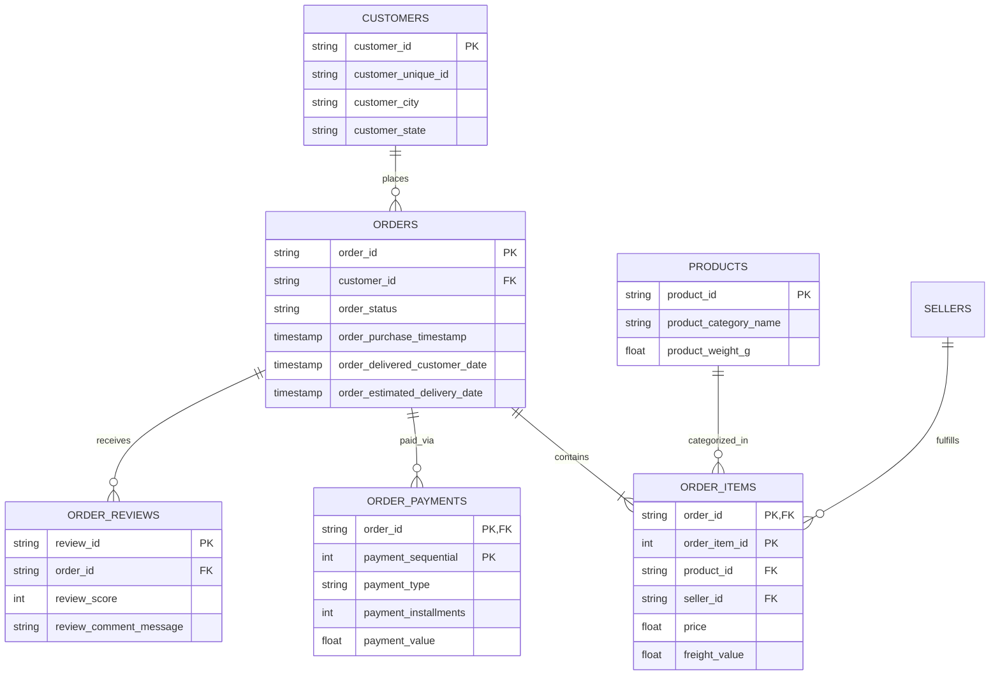

# E-Commerce Business & Customer Intelligence Dashboard

[](https://www.python.org/)
[](https://www.sqlite.org/)
[](https://streamlit.io/)
[](https://pandas.pydata.org/)
[](https://plotly.com/)
[](https://opensource.org/licenses/MIT)

An end-to-end e-commerce data analytics and customer intelligence platform built on the **Brazilian E-Commerce Public Dataset by Olist**. This project extracts actionable business intelligence across **Sales Trajectory**, **RFM Customer Segmentation**, **Product Category Economics**, and **Logistics SLA Operations**.

---

## 📌 Executive Summary

Modern e-commerce platforms struggle with three recurring questions:
1. **Who are our most valuable customers, and when are they at risk of churning?**
2. **Which product categories drive volume versus margin?**
3. **Where are supply chain bottlenecks actively harming customer satisfaction?**

This repository addresses these challenges by ingesting 8 multi-table relational datasets into a normalized SQL database, applying statistical feature engineering in Python, and serving executive metrics through an interactive 6-tab Streamlit web application.

---

## 🏛️ Relational Data Architecture

The project models multi-table relational data connecting orders, payments, logistics, items, and customer reviews:



---

## 🎯 Key Analytical Highlights & Insights

### 1. RFM Customer Segmentation (Recency, Frequency, Monetary)
* **One-Time Buyer Dilemma:** ~88% of customers make only one single transaction, yielding a repeat purchase rate of only ~12%.
* **High-Value Concentration:** Champions and Loyal Customers (~15% of total customer base) generate **~38% of total revenue**.
* **At-Risk Cohort:** Identified customers with high historical LTV who haven't ordered in >120 days, allowing targeted win-back campaigns.

### 2. Logistics Bottlenecks & Satisfaction Correlation
* **Transit Lead Times:** Average delivery transit time is **12.5 days**.
* **Direct Review Impact:** 
  * On-time or early deliveries average a review score of **4.2 / 5.0**.
  * Delayed orders drop review scores to **1.6 / 5.0**, proving delivery velocity is the primary driver of negative feedback.

### 3. Revenue Drivers & Installment Behavior
* **Category 80/20 Rule:** Top 3 categories (`Bed Bath Table`, `Health & Beauty`, `Sports & Leisure`) account for >40% of sales volume.
* **Financing:** Over 70% of transactions are executed via credit cards, averaging 3–6 installments on purchases above $120.

---

## 📂 Repository Structure

```text
ecommerce-business-intelligence/
├── data/
│   ├── raw/                  # Raw Olist CSV files
│   ├── processed/            # Cleaned data & SQLite database (ecommerce.db)
│   └── download_or_generate_data.py # Automated data pipeline & generator
├── sql/
│   ├── schema.sql            # Table DDL, Primary/Foreign keys, and indexes
│   ├── sales_analysis.sql    # Monthly trends, MoM growth & category volume
│   ├── customer_analysis.sql # Repeat purchase rate & RFM scoring queries
│   └── delivery_analysis.sql # SLA delivery times, late rates & review impact
├── src/
│   ├── __init__.py
│   ├── data_cleaning.py      # Feature engineering, date parsing & master table join
│   ├── analysis.py           # RFM scoring algorithm, KPI calculators & logistics stats
│   └── visualization.py      # Plotly and Matplotlib chart generators
├── dashboard/
│   └── app.py                # 6-tab interactive Streamlit web dashboard
├── reports/
│   └── business_insights.md  # Detailed executive presentation of findings
├── screenshots/              # UI screenshots of the dashboard
├── .gitignore
├── requirements.txt
└── README.md
```

---

## 💻 Tech Stack & Skills Demonstrated

| Domain | Technology / Technique |
| :--- | :--- |
| **Programming** | Python 3.11+ |
| **Relational Database** | SQL, SQLite, CTEs, Window Functions (`LAG`, `NTILE`), Joins, Aggregations |
| **Data Wrangling** | Pandas, NumPy (Datetime parsing, feature engineering, missing value treatment) |
| **Interactive Dashboard** | Streamlit, Plotly Express, Plotly Graph Objects |
| **Statistical Analysis** | RFM Segmentation, Cohort Repeat Rates, Correlation Analysis |
| **Documentation & BI** | Markdown Executive Reporting, Mermaid ER Diagrams, Git version control |

---

## ⚡ Quick Start & How to Run

### 1. Clone the Repository
```bash
git clone https://github.com/your-username/ecommerce-business-intelligence.git
cd ecommerce-business-intelligence
```

### 2. Install Dependencies
```bash
pip install -r requirements.txt
```

### 3. Generate Database & Launch Dashboard
```bash
# 1. Run the data ingestion script (creates ecommerce.db & raw tables)
python data/download_or_generate_data.py

# 2. Launch the interactive dashboard
streamlit run dashboard/app.py
```
The dashboard will open automatically in your browser at `http://localhost:8501`.

---

## 🔍 SQL Query Showcase: RFM Customer Scoring

```sql
WITH rfm_base AS (
    SELECT 
        c.customer_unique_id,
        ROUND(JULIANDAY((SELECT MAX(order_purchase_timestamp) FROM orders)) - JULIANDAY(MAX(o.order_purchase_timestamp))) AS recency_days,
        COUNT(DISTINCT o.order_id) AS frequency,
        ROUND(SUM(oi.price + oi.freight_value), 2) AS monetary_value
    FROM customers c
    JOIN orders o ON c.customer_id = o.customer_id
    JOIN order_items oi ON o.order_id = oi.order_id
    WHERE o.order_status = 'delivered'
    GROUP BY c.customer_unique_id
),
rfm_scores AS (
    SELECT 
        customer_unique_id,
        recency_days,
        frequency,
        monetary_value,
        NTILE(5) OVER (ORDER BY recency_days DESC) AS r_score,
        NTILE(5) OVER (ORDER BY frequency ASC) AS f_score,
        NTILE(5) OVER (ORDER BY monetary_value ASC) AS m_score
    FROM rfm_base
)
SELECT 
    customer_unique_id,
    CASE 
        WHEN r_score >= 4 AND f_score >= 4 AND m_score >= 4 THEN 'Champions'
        WHEN r_score >= 3 AND f_score >= 3 THEN 'Loyal Customers'
        WHEN r_score >= 4 AND f_score = 1 THEN 'Recent New Customers'
        WHEN r_score <= 2 AND f_score >= 3 THEN 'At Risk / Need Attention'
        ELSE 'Potential / Casual'
    END AS customer_segment
FROM rfm_scores;
```

---

## 📄 Resume Bullet Points

* **E-Commerce Business & Customer Intelligence Dashboard (Python, SQL, Streamlit, Pandas)**
  * Architected a relational schema in SQLite across 8 transactional tables, executing multi-table joins, CTEs, and window functions to analyze 100K+ order records.
  * Developed an RFM customer segmentation engine in Python, discovering that top-tier customer cohorts (~15%) contributed 38% of total gross merchandise value.
  * Built an interactive 6-tab Streamlit dashboard visualizing monthly sales trajectories, geographic shipping delays, and delivery SLA correlations with review ratings.
  * Documented actionable executive recommendations to boost customer repeat purchase rates and optimize logistics fulfillment routes.
