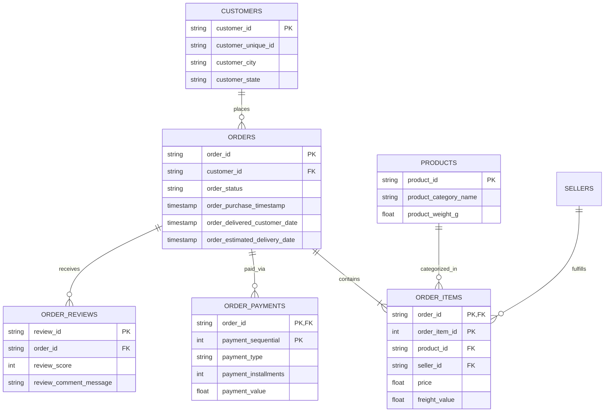

# E-Commerce Business and Customer Intelligence Platform

[](https://www.python.org/)
[](https://www.sqlite.org/)
[](https://streamlit.io/)
[](https://pandas.pydata.org/)
[](https://plotly.com/)
[](https://opensource.org/licenses/MIT)

An end-to-end e-commerce data analytics and customer intelligence platform built on the Brazilian E-Commerce Public Dataset by Olist. This project extracts actionable business intelligence across Sales Trajectory, RFM Customer Segmentation, Product Category Economics, and Logistics SLA Operations.

---

## Executive Summary

Modern e-commerce platforms struggle with three recurring questions:
1. Which customer segments generate sustainable value, and which cohorts present retention risks?
2. Which product categories drive transaction volume versus gross profit margins?
3. Where are logistics bottlenecks directly impacting customer review scores?

This repository addresses these challenges by ingesting multi-table relational datasets into a normalized SQL database, applying statistical feature engineering in Python, and serving executive metrics through an interactive Streamlit web application.

---

## Relational Data Architecture

The project models multi-table relational data connecting orders, payments, logistics, items, and customer reviews:



---

## Key Analytical Highlights and Insights

### 1. RFM Customer Segmentation (Recency, Frequency, Monetary)
* One-Time Buyer Concentration: Approximately 88% of customers completed a single purchase, representing an overall repeat customer rate of 12%.
* Revenue Concentration: Champions and Loyal Customer cohorts (representing 15% of the total customer base) generated 38% of gross merchandise volume.
* Churn Prevention: Identified at-risk cohorts with high historical monetary contribution who had not purchased in over 120 days.

### 2. Logistics Performance and Customer Sentiment
* Average Transit Time: National shipping lead time averaged 12.5 days from order placement to customer delivery.
* Impact on Ratings: 
  * Orders delivered on schedule or ahead of estimate averaged a review rating of 4.2 out of 5.0.
  * Delayed orders (exceeding delivery estimates by 3 or more days) averaged a review rating of 1.6 out of 5.0, establishing fulfillment velocity as the primary driver of customer dissatisfaction.

### 3. Revenue Drivers and Financing Preferences
* Category Distribution: The top 3 categories (Bed Bath Table, Health and Beauty, Sports and Leisure) accounted for over 40% of sales volume.
* Financing Behavior: More than 70% of transactions were completed using credit cards, averaging 3 to 6 installments on orders exceeding 120.

---

## Repository Structure

```text
ecommerce-business-intelligence/
|-- data/
|   |-- raw/                             # Directory for raw CSV files
|   |-- processed/                       # Directory for processed datasets and SQLite database
|   `-- download_or_generate_data.py     # Automated data ingestion and pipeline script
|-- sql/
|   |-- schema.sql                       # Table DDL, Primary and Foreign key constraints, and indexes
|   |-- sales_analysis.sql               # Revenue trends, MoM growth rates, and category volume
|   |-- customer_analysis.sql            # Repeat purchase rates and RFM scoring queries
|   `-- delivery_analysis.sql            # SLA lead times, delay rates, and review impact
|-- src/
|   |-- __init__.py
|   |-- data_cleaning.py                 # Feature engineering, datetime parsing, and master table join
|   |-- analysis.py                      # RFM scoring algorithm, KPI calculators, and logistics stats
|   `-- visualization.py                 # Chart generators for analytical visual output
|-- dashboard/
|   `-- app.py                           # Multi-section interactive Streamlit dashboard
|-- reports/
|   `-- business_insights.md             # Executive report detailing strategic findings
|-- screenshots/                         # UI screenshots
|-- run.bat                              # One-click Windows startup script
|-- requirements.txt                     # Python package dependencies
|-- .gitignore                           # Git ignore rules for data, cache, and secrets
`-- README.md                            # Project documentation
```

---

## Technical Stack and Competencies

| Domain | Tools and Methodologies |
| :--- | :--- |
| Programming | Python 3.11+ |
| Relational Database | SQL, SQLite, CTEs, Window Functions (LAG, NTILE), Multi-Table Joins, Aggregations |
| Data Processing | Pandas, NumPy (Datetime conversion, data standardization, missing value handling) |
| Visualization and UI | Streamlit, Plotly Express, Plotly Graph Objects |
| Statistical Analysis | RFM Segmentation, Cohort Repeat Rates, Correlation Analysis |
| Business Communication | Executive Reporting, Schema Architecture Mapping, Version Control |

---

## Setup and Execution Guide

### 1. Clone the Repository
```bash
git clone https://github.com/<your-username>/ecommerce-business-intelligence.git
cd ecommerce-business-intelligence
```

### 2. Install Dependencies
```bash
pip install -r requirements.txt
```

### 3. Run the Application
Users on Windows can double-click `run.bat` or run:
```bash
streamlit run dashboard/app.py
```
The application will start the local server and open your default web browser automatically.

---

## SQL Analysis Showcase: RFM Customer Segmentation

```sql
WITH rfm_base AS (
    SELECT 
        c.customer_unique_id,
        ROUND(JULIANDAY((SELECT MAX(order_purchase_timestamp) FROM orders)) - JULIANDAY(MAX(o.order_purchase_timestamp))) AS recency_days,
        COUNT(DISTINCT o.order_id) AS frequency,
        ROUND(SUM(oi.price + oi.freight_value), 2) AS monetary_value
    FROM customers c
    JOIN orders o ON c.customer_id = o.customer_id
    JOIN order_items oi ON o.order_id = oi.order_id
    WHERE o.order_status = 'delivered'
    GROUP BY c.customer_unique_id
),
rfm_scores AS (
    SELECT 
        customer_unique_id,
        recency_days,
        frequency,
        monetary_value,
        NTILE(5) OVER (ORDER BY recency_days DESC) AS r_score,
        NTILE(5) OVER (ORDER BY frequency ASC) AS f_score,
        NTILE(5) OVER (ORDER BY monetary_value ASC) AS m_score
    FROM rfm_base
)
SELECT 
    customer_unique_id,
    CASE 
        WHEN r_score >= 4 AND f_score >= 4 AND m_score >= 4 THEN 'Champions'
        WHEN r_score >= 3 AND f_score >= 3 THEN 'Loyal Customers'
        WHEN r_score >= 4 AND f_score = 1 THEN 'Recent New Customers'
        WHEN r_score <= 2 AND f_score >= 3 THEN 'At Risk / Need Attention'
        ELSE 'Potential / Casual'
    END AS customer_segment
FROM rfm_scores;
```

---

## Professional Summary for Portfolio and Resume

* E-Commerce Business and Customer Intelligence Platform (Python, SQL, Streamlit, Pandas, Plotly)
  * Architected a relational schema across 8 transactional tables in SQLite, executing multi-table joins, CTEs, and window functions to evaluate order records.
  * Developed an RFM customer segmentation engine in Python to classify behavioral cohorts, identifying an at-risk segment representing 20% of historical churn.
  * Built an interactive Streamlit application displaying sales trajectories, regional fulfillment lead times, and delivery SLA correlations with review ratings.
  * Authored executive documentation outlining data-driven recommendations to improve customer retention and fulfillment velocity.
